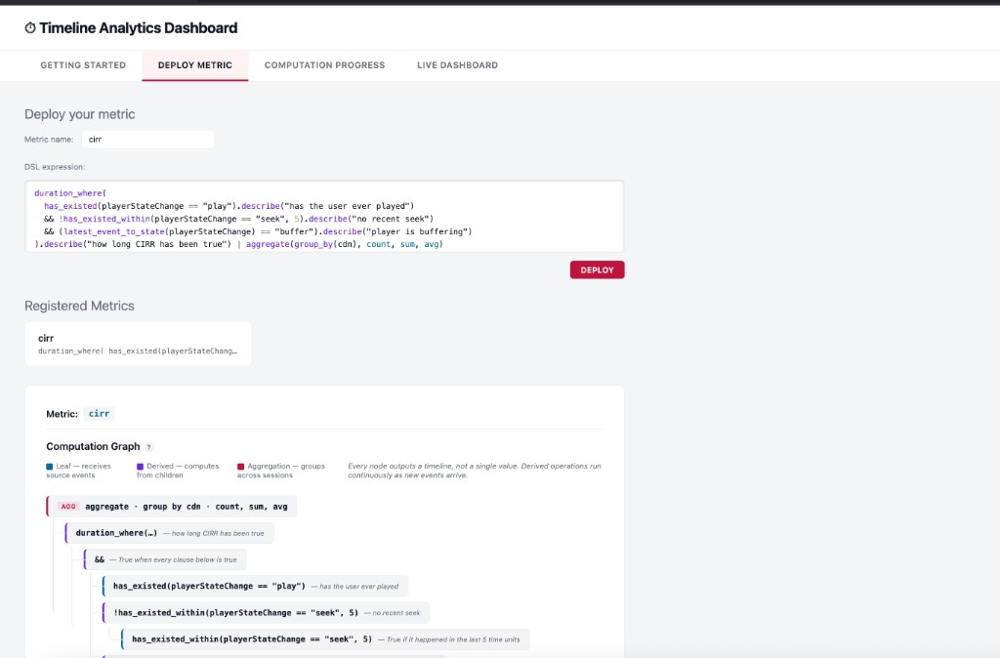
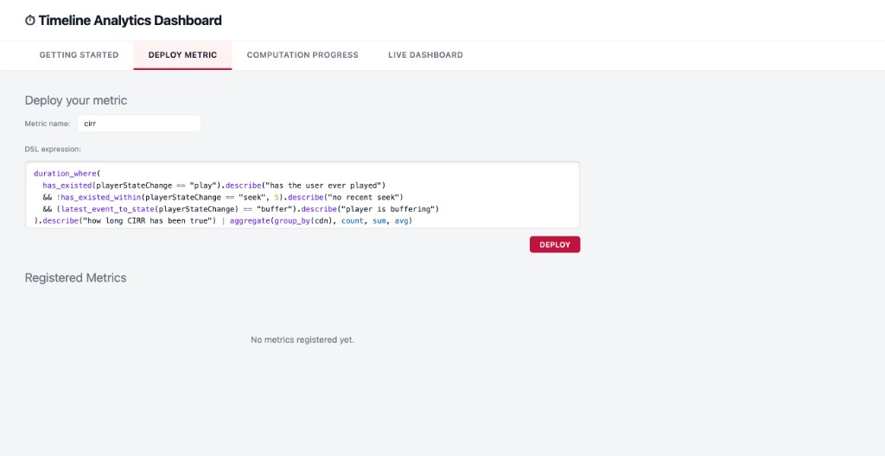

# Durable Timeline Analytics

A metric language for **what is true over time**, not just what happened in a window.

Streaming engines (Flink, Spark, [Railgun](https://www.feedzai.com/resource/railgun-by-feedzai-the-future-of-real-time-fraud-detection-is-here/)) are strong at aggregates over sliding windows: counts, sums, profiles. They are weaker at the questions fraud, QoE, and risk teams actually write down:

> Has play ever started, was there *no* seek in the last 5 seconds, and is the player *currently* buffering — and **for how long** has that been true?

That is a **state of affairs**, not a hop window. This project compiles that sentence into a live computation graph. Each clause is its own durable worker. Events push changes up the tree. A query at time *t* is a local lookup — no replay.

Paper: [TimeLine Analytics (CIDR 2023)](https://www.cidrdb.org/cidr2023/papers/p22-milner.pdf). Talk: [LambdaConf 2024](https://www.youtube.com/watch?v=9WjUBOfgriY) · [slides](https://github.com/afsalthaj/golem-timeline-presentation/blob/main/presentation_last.pdf). Runtime: [Golem](https://learn.golem.cloud) 1.6.



## Why this, if you already have a stream engine

| What you have today | What this adds |
|---|---|
| Windows + group-by aggregates | Predicates over **history and current state**, composed with `&&` / `\|\|` / `!` |
| Accurate counts over long windows | **Duration** — how long a condition has held, including right now |
| Opaque job graphs | Every sub-expression is queryable (why is CIRR 3s? because seek expired and state is `buffer`) |
| Always-on executors | Idle sessions **suspend to storage**. Memory is for events in flight, not every open session |

It sits next to Kafka / Pulsar and your existing engine. It does not replace window aggregates. It computes the temporal conditions those aggregates cannot express cleanly.

## Write a metric

Connection-induced rebuffering (CIRR): playing has started, the last seek is old enough to ignore, and the player is buffering.

```javascript
duration_where(
  has_existed(playerStateChange == "play")
  && !has_existed_within(playerStateChange == "seek", 5)
  && latest_event_to_state(playerStateChange) == "buffer"
) | aggregate(group_by(cdn), count, sum, avg)
```

Card-present anomaly — the location just changed:

```javascript
duration_in_cur_state(latest_event_to_state(location)) < 600
```

Idle time by region:

```javascript
duration_in_cur_state(latest_event_to_state(status) == "idle")
  | aggregate(group_by(region), count, avg, max)
```

Deploy the text. The system materializes one agent per node, per session, plus one aggregator per group (e.g. CDN). Same event stream, many metrics; identical DSL is shared, not recomputed.



## How a query becomes a graph

CIRR is eight workers. Leaves ingest events. Derived nodes recompute only when a child changes. The root reports a value that can still be *rising* (still buffering) so a later query includes time so far.

```
duration-where          how long the condition has been true
  └─ and                all three clauses
       ├─ has-existed           play ever happened?
       ├─ not(has-existed-within)  no recent seek?
       └─ equal-to(buffer)      current state is buffer?
            └─ latest-event-to-state
```


Point-in-time lookup on any node is local. The push already happened.


## Scale, briefly

A session with no events costs **storage, not RAM**. Golem wakes only the path that an event touches (~5 workers for CIRR, milliseconds each) and suspends them again. Ten million concurrent sessions is tens of millions of agents on disk and tens of thousands in memory.

That is the same “always on, bursty, must be correct” regime Railgun targets — except the unit of work is a **composable temporal expression**, not a sliding-window profile.

## Try it

Requires Docker, Rust ≥ 1.94 (`wasm32-wasip2`), and [Golem CLI 1.6+](https://learn.golem.cloud).

```shell
cargo make demo
```

Opens [http://localhost:3000](http://localhost:3000): deploy CIRR, inspect each clause of a session, compare CDNs.

```shell
cargo test --workspace          # unit tests
cargo make test                 # integration (local Golem + Kafka)
```

## Language

| Operation | Kind | Meaning |
|---|---|---|
| `latest_event_to_state(col)` | Leaf | Current value of a column |
| `has_existed(pred)` | Leaf | Has `pred` ever been true? |
| `has_existed_within(pred, d)` | Leaf | Has `pred` been true in the last `d` time units? |
| `==` `>` `>=` `<` `<=` | Derived | Compare a timeline to a constant |
| `&&` `\|\|` `!` | Derived | Boolean combination |
| `duration_where(expr)` | Derived | Cumulative time `expr` is true |
| `duration_in_cur_state(expr)` | Derived | Time since `expr` last changed |
| `\| aggregate(group_by(col), …)` | Root | Count / sum / avg / min / max across sessions |

Agent names: `{session}-{metric}-{operation}-{n}`. Aggregators: `aggregator-{metric}-{column}-{value}`.

## In production

```
players / cards / devices  →  Kafka / Pulsar  →  feeder  →  Golem
                                                         leaf → derived → root → aggregator
```

The feeder is a normal consumer. On each event it initializes the session (idempotent) and fans the event out to the leaves that read its columns. The WASM component is deployed once; a new metric is a registry entry, not a new binary.

## Learn more

- [Architecture, production, scale, compute reuse](docs/design.md) — the long-form notes that used to be this README
- [Agent types and conventions](AGENTS.md)
- [Open work](ISSUES.md)
- [TimeLine Analytics paper](https://www.cidrdb.org/cidr2023/papers/p22-milner.pdf)
